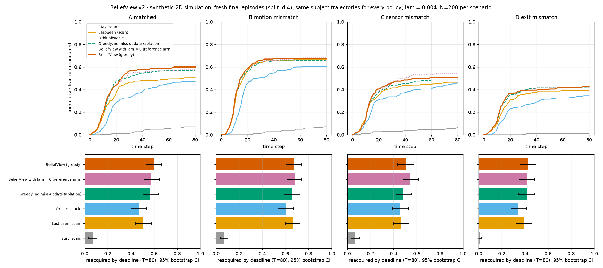

# BeliefView: active search under occlusion (synthetic simulations)

This repository holds two separate, **synthetic** simulations of an observer drone searching for a subject that has slipped behind cover:

- **The 2D research study** ([next section](#the-2d-study)): a frozen, reproducible experiment with reported results and limitations.
- **A 3D illustrative demo** ([`demo3d/`](demo3d/README.md), introduced [below](#3d-demo-illustrative-synthetic-not-validated)): an interactive forest scene. It is not part of the 2D study's evidence.

Neither is computer vision or a flight controller, and neither makes any claim about real drone performance.

## The 2D study

The 2D study is a reproducible **synthetic 2D simulation**. It is not computer vision, not a flight controller, and it makes no claim about real drone performance. Every number reported for the 2D study comes from simulated episodes on one hand-built map.

**The question.** An observer "drone" loses sight of a moving subject behind opaque cover. If it keeps a probability belief over where the subject could be, and updates that belief every time it looks and sees nothing, does it find the subject again more often than simple search patterns do?

**The short answer (v2, the headline run).** Partly, and at a cost. BeliefView reacquired the subject more often than flying to the last-seen point and scanning in the matched scenario (0.60 against 0.51 of 200 episodes), but it flew about twice as far, and under mismatched motion or a mismatched sensor the two were indistinguishable. Updating the belief on misses, the idea the project was built around, showed no clear benefit to reacquisition in any of the four scenarios. Details and caveats are below and in the [full technical report](docs/TECHNICAL_REPORT.md).

AI assistance: Claude wrote the code and Codex reviewed it independently. Models, passes and what each did are in [CONTRIBUTIONS.md](CONTRIBUTIONS.md). The internal review record (`REVIEW_NOTES.md`) and the task plans and briefs are not published in this snapshot; see [docs/PUBLIC_SNAPSHOT.md](docs/PUBLIC_SNAPSHOT.md).

## 3D demo (illustrative, synthetic, not validated)

[`demo3d/`](demo3d/README.md) is a separate, self-contained browser demo of a simulated drone searching a simulated forest for a simulated evasive subject. Its own README describes its scenes, controls, optional modes, tests and limitations, and is the place to check what it does.

**How it relates to the 2D study.** It is a different simulator with hand-written behaviour, hand-tuned constants and a chosen scenario seed. It does **not** reuse the frozen v2 filter, parameters or results, and it does **not** validate, confirm or extend them. Do not compare any 3D number or behaviour with the v2 numbers on this page, and do not read it as evidence of real-world performance.

To run it locally (see [`demo3d/README.md`](demo3d/README.md) for requirements and options):

```
cd demo3d
npm install
npm run dev     # then open http://localhost:5173
npm test        # the demo's own test suite
```

## What it does

- **Belief.** A grid Bayes filter over position and heading, with an absorbing "outside the search area" state. A look that misses lowers the probability of the cells that were visible and raises everything else, including "outside".
- **Planner.** A **greedy, not globally optimal** viewpoint planner. It scores candidate viewpoints by the predicted chance of reacquiring the subject within 12 steps, minus a travel penalty (lam) per step of travel, executes 3 steps and replans.
- **Comparison.** Five policies run on identical, paired, held-out episodes: Stay (scan in place), Last-seen (go to the noisy last-seen point, then scan), Orbit (circle the nearest obstacle), the same planner with miss updates switched off (the ablation), and BeliefView.
- **Ground truth** is stored separately from what the policies observe. Where it appears in the demo and clips it is labelled **evaluation-only ground truth**.

## See it

GitHub cannot run the demo page inside this README. Clone or download the repository, then open [`demo/index.html`](demo/index.html) in a browser (double-click it; no server, login or network). It has both animations with pause, scrub and single-frame steps, the matched-case comparison, the failure clip and the limitations, all generated from the v2 result files.

The two clips are also in the repository as files. GitHub does not play them inline from this page; follow the link and use the file view, or download them:

- [`results/v2/animation_representative.mp4`](results/v2/animation_representative.mp4): a scenario A (matched) BeliefView success with the median detection time. Like the failure clip, it is an illustrative episode selected by outcome.
- [`results/v2/animation_failure.mp4`](results/v2/animation_failure.mp4): an illustrative plain miss in scenario B (motion mismatch). The subject kept walking, was still inside at the deadline and was never seen. The episode was selected by outcome using a fixed rule. It is not an example of the false "left the area" call described under limitations.

## Run it locally

```
make setup   # once: creates .venv, installs numpy, matplotlib, pytest
make test    # runs the test suite; writes no result file
```

`make all` runs the tests and then rebuilds the v2 tables, figures, animations and demo from the saved v2 records (about 2 minutes). It rewrites those generated files in `results/v2/` and `demo/`, and it does not rerun the v2 final experiment. That run happened once; `make v2-tune` and `make v2-final` now refuse to run again. All targets, including the labelled reproducibility checks, are listed in the [technical report](docs/TECHNICAL_REPORT.md#one-command).

## The v2 protocol in brief

- The map, scenarios, sensor, subject model and planner settings were carried over from the earlier v1 run and not re-tuned. Two things changed: the rule for choosing the travel penalty, and the episodes.
- One shared, strictly positive travel penalty was tuned on 100 new validation episodes in each of scenarios A and B. The rule took the largest value on a four-value grid whose reacquired fraction was within 0.03 of the grid's best. It selected **lam = 0.004**. The ablation inherits the same value.
- The config, protocol, seed mapping and a checksum of the simulation and inference source were then frozen ([`config/frozen_v2.json`](config/frozen_v2.json)). The final run was made **once**, on **200 fresh final episodes per scenario**, the same episodes for every policy. A lock file blocks a second run.
- BeliefView with lam = 0 was run on the same final episodes only as a labelled **reference arm**, to measure what the penalty did. It was never a tuning candidate and is not a headline result.
- Four scenarios: **A** matched (the filter's assumptions are the simulator's); **B** motion mismatch (long stops, doubling back); **C** sensor mismatch (the true sensor is weaker than assumed); **D** exit-heavy truth (more subjects leave than the filter assumes).
- Reacquisition means the first positive detection. Searches that reach the 80-step deadline count as unresolved. Intervals are 95% percentile bootstraps over episodes, differences are paired, and **intervals are not adjusted for the number of comparisons**.

## Headline result (v2)



*Figure: [`results/v2/comparison.png`](results/v2/comparison.png). Synthetic 2D simulation, v2 final run, 200 paired episodes per scenario, lam = 0.004. Top row: cumulative fraction reacquired by time step. Bottom row: fraction reacquired by the deadline (T = 80) with 95% bootstrap intervals for each policy on its own. The "BeliefView with lam = 0" arm is a reference arm, not a headline result. Overlapping bars are not the test: the conclusions below rest on paired per-episode differences, which are tabulated in [`results/v2/results.md`](results/v2/results.md).*

Reacquired by the deadline [95% CI]:

| scenario | Stay | Last-seen | Orbit | Ablation (no miss update) | **BeliefView** |
|---|---|---|---|---|---|
| A matched | 0.07 | 0.51 [0.44, 0.57] | 0.47 | 0.57 [0.51, 0.64] | **0.60 [0.53, 0.67]** |
| B motion mismatch | 0.07 | 0.67 [0.60, 0.73] | 0.60 | 0.66 [0.59, 0.72] | **0.68 [0.60, 0.74]** |
| C sensor mismatch | 0.07 | 0.47 [0.40, 0.54] | 0.46 | 0.48 [0.42, 0.56] | **0.51 [0.43, 0.57]** |
| D exit mismatch | 0.01 | 0.39 [0.33, 0.46] | 0.34 | 0.41 [0.34, 0.48] | **0.42 [0.35, 0.49]** |

What the paired differences (BeliefView minus the other policy) support:

- **Against Stay:** +0.415 to +0.605 in every scenario, intervals far from 0.
- **Against Last-seen:** +0.10 [0.05, 0.15] in A, which clearly excludes 0. +0.04 [0.01, 0.07] in D, which excludes 0 narrowly (9 episodes against 2) and might not survive an adjustment for the number of comparisons. +0.01 [-0.03, 0.05] in B and +0.04 [-0.01, 0.09] in C: not distinguishable from "go to the last-seen point and scan".
- **Against Orbit:** +0.13 [0.06, 0.21] in A, +0.07 [0.01, 0.14] in B, +0.08 [0.02, 0.14] in D, and +0.05 [-0.02, 0.11] in C, which includes 0.
- **Against the ablation (the primary comparison):** +0.01 to +0.03, and every interval includes 0. Miss updates made no statistically distinguishable difference to reacquisition or search time in any scenario.

Travel is reported separately, because the four comparisons point in different directions:

- **Against Last-seen, BeliefView costs travel.** It flies about 1.8 to 2.2 times as far in every scenario (37 against 18 units in A).
- **Against Orbit, it saves travel.** About half as far (37 against 81 units in A).
- **Against the lam = 0 reference arm,** the positive penalty cut travel by 12 to 20 units per episode, about a quarter to a third. Reacquisition was not distinguishable from the reference arm in A, B and D. In C it was possibly lower: -0.040 [-0.085, +0.000], a borderline, unadjusted result reported as a possible cost, not an established one.
- **Against the ablation,** miss updates shortened travel by 3.8 to 6.5 units per episode. That is their one measurable effect.

Two weaker results about what the system reports when it fails to find the subject:

- **False "left the area" calls.** At the deadline BeliefView declares that the subject left if P(outside) is at least 0.9. Among unresolved runs whose subject was still inside, it made that call wrongly in 4 of 11 (A), 2 of 9 (B), 5 of 14 (C) and 0 of 4 (D). The denominators are too small to estimate a rate, but false calls happened even in the matched scenario.
- **Region coverage.** The conditional in-area 90% region contained the true position in 7 of 11 (A), 7 of 9 (B), 8 of 14 (C) and 2 of 4 (D) of those same runs. Coverage is not established with denominators this small, and every one of these is below what 90% would suggest.

All tables, including search time, the outside decision, exit-rate sensitivity and the split by subject behaviour, are in [`results/v2/results.md`](results/v2/results.md) and explained in the [technical report](docs/TECHNICAL_REPORT.md).

## Failures and honest limitations

The full list, with numbers, is in the [technical report](docs/TECHNICAL_REPORT.md#failures-and-honest-limitations). The main points:

- **A modest result.** BeliefView beats staying still everywhere and a fixed orbit in three of four scenarios. It beats last-seen-then-scan clearly only in the matched scenario and narrowly in the exit-heavy one, while flying about twice as far in all four.
- **Miss updates did not show a benefit in v2.** The earlier v1 run reported a few-point benefit in two scenarios. It did not hold up on fresh episodes.
- **Model mismatch.** Under mismatched motion BeliefView matched the last-seen baseline at 1.8 times the travel, and its deadline report was unreliable.
- **Many subjects leave.** 97 to 140 of the 200 subjects per scenario leave the map before the deadline. This caps every method's reacquisition rate.
- **No false positives.** The simulated sensor never reports a subject that is not there. Real detectors are not like this, and nothing here measures how the filter or planner would cope.
- **The look gate rewards movement,** and looks that count are treated as independent. That is an assumption that favours moving policies.
- **The travel penalty is a trade,** chosen by a rule on a small grid; nothing larger than 0.004 was tried.
- **Intervals are unadjusted.** Many paired comparisons are reported, and the marginal ones could be chance.
- **v2 is a fresh sample, not an independent replication.** Its scenarios and map were designed while looking at v1-era results.
- **Simulation is not reality.** Abstract 2D rectangles, one fixed map, perfect self-pose, no perception errors, no altitude, camera projection, gimbal, wind, latency, battery or real control dynamics, hand-written subject behaviours, and an assumed sensor model. Nothing here predicts real drone performance, and nothing here is an operational system.

## What not to claim

Don't say it beats simple search generally, that it "finds people faster", that the planner is optimal, that it is an operational system, or anything about real drones. Say what the confidence intervals support. An evidence-based 30-second description is in the [technical report](docs/TECHNICAL_REPORT.md#30-second-description-evidence-based-draft-84-words-reid-to-edit-only-with-what-he-can-explain).

No document in this repository states that Reid has personally verified the project. His own review steps are in [REVIEW_PATH.md](REVIEW_PATH.md), and the checklist in [CONTRIBUTIONS.md](CONTRIBUTIONS.md) is his to tick.

## Hand-check

One missed-detection update can be worked by hand and checked against the code. This snippet prints the detection probability for a visible cell and for a cell hidden behind an obstacle; [REVIEW_PATH.md](REVIEW_PATH.md) walks through the rest.

```
.venv/bin/python - <<'PY'
import sys; sys.path.insert(0,'.')
from beliefview.config import MapConfig, SensorParams
from beliefview.belief import GridGeometry
from beliefview.sensor import Pose
g = GridGeometry(MapConfig()); pd = g.pd_field(SensorParams(), Pose(20.0, 9.5, 0.0))
print("visible cell (iy=9,ix=23) P(detect) =", pd[9, 23], "; hidden behind rock (iy=9,ix=30) =", pd[9, 30])
PY
```

## Where things are

| What | Where |
|---|---|
| Full technical report: model, evaluation design, every v2 and v1 table, limitations, related work | [docs/TECHNICAL_REPORT.md](docs/TECHNICAL_REPORT.md) |
| v2 results (headline): tables, CSVs, figures, clips, experiment log, per-episode records | [results/v2/](results/v2/), starting with [results.md](results/v2/results.md) |
| v2 figures | [comparison.png](results/v2/comparison.png), [exit_rate_sensitivity.png](results/v2/exit_rate_sensitivity.png), [map.png](results/v2/map.png) |
| v2 frozen config, protocol, seed mapping and tuning log | [config/frozen_v2.json](config/frozen_v2.json) |
| Earlier v1 record (lam = 0, 100 test episodes per scenario, run twice; different episodes, not merged with v2) | [results/](results/) top level (see [results/README.md](results/README.md)), [config/frozen.json](config/frozen.json), and a checksummed copy in [archive/v1/](archive/v1/) |
| 3D illustrative demo (separate from the 2D study; synthetic, not validated) | [demo3d/](demo3d/), starting with [demo3d/README.md](demo3d/README.md) |
| Local 2D demo and the two animations | [demo/index.html](demo/index.html) (open from a local checkout), [demo/](demo/) |
| Related-work notes | [LITERATURE_NOTES.md](LITERATURE_NOTES.md), and the related-work section of the [technical report](docs/TECHNICAL_REPORT.md#related-work) |
| Four-hour review path, quiz and answer key | [REVIEW_PATH.md](REVIEW_PATH.md), [QUIZ.md](QUIZ.md), [QUIZ_ANSWER_KEY.md](QUIZ_ANSWER_KEY.md) |
| Who did what, and the AI-assistance disclosure | [CONTRIBUTIONS.md](CONTRIBUTIONS.md) |
| About this public snapshot: which internal records are not published, and why some references point at them | [docs/PUBLIC_SNAPSHOT.md](docs/PUBLIC_SNAPSHOT.md) |
| Plans, briefs and review ledgers | Internal records, not published in this snapshot (see [docs/PUBLIC_SNAPSHOT.md](docs/PUBLIC_SNAPSHOT.md)) |
| Code, tests and scratch scripts | [beliefview/](beliefview/), [tests/](tests/), [scripts/](scripts/) |
